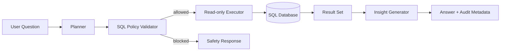

# 🔐 Secure Data Copilot

**A MAK'MA Studio Product · MAK'MA Labs**

[Live Product Demo](https://maharshimak.github.io/makma-ai-os/projects/secure-data-copilot/) · [MAK'MA Labs](https://maharshimak.github.io/makma-ai-os/projects/)

A local **read-only analytics copilot** for relational data. The system is designed around a strict rule: an AI assistant may help reason over business data, but it must not silently gain write access to the database.


## Product contract — engineering upgrade

**Problem and audience:** A safe local analytics workspace for engineers inspecting how questions become bounded business-data queries.

**Live tool:** https://maharshimak.github.io/makma-ai-os/projects/secure-data-copilot/

**Implemented browser workflow:** Editable synthetic customers/orders, supported natural-language question templates, schema privacy findings with reasons, read-only query inspection, risk budget, computed rows/statistics and CSV/JSON export. Mutation intent is rejected before planning.

**Backend and parity contract:** Browser executes a structured deterministic local query plan, NOT the displayed SQL. Python parses SQLite SQL with `sqlglot`, requires exactly one read-only query expression, rejects forbidden AST operations/functions, wraps the result with an outer row limit, and executes through a native read-only/query-only SQLite connection. The planner remains deterministic and returns confidence=None because its rules do not produce calibrated probabilities. CSV cells beginning with formula characters are neutralized.

**Architecture:** `makma-ai-os/demo` is the shared web product source and Pages deployment. This repository owns its Python domain package. The central `tests/e2e` suite exercises all nine products; `tests/fixtures/python-parity.json` plus `scripts/generate_parity.py` guard shared mathematical contracts. Backend revisions used for regeneration are pinned in the central `backend-lock.json`.

**Safety and limitations:** The browser remains a deterministic four-family demo. The Python backend also supports an optional OpenAI-compatible schema-aware planner, but every proposed statement is treated as untrusted and must pass table/column authorization, structural query-complexity limits, a query-risk budget, the parsed SQL AST policy, and the native read-only SQLite boundary before execution. Browser permits at most 1000 customers and 10000 orders. Bearer authentication exists for remote API access; true multi-user identity/session ownership and database row-level security are not implemented. Inputs are validated, rendered user values are escaped, and deterministic results are not presented as model inference.

**Verification:** Run `python -m ruff check .` and `python -m pytest -q`. `tests/test_engineering_upgrade.py` protects the new rejection/correctness paths. Central web checks: `npm ci`, `npm test`, `npm run build`, `npx playwright install --with-deps chromium`, `npm run test:e2e`. CI gates publishing on browser interactions and validates all public URLs after deployment.

**Highest-value next work:** Row-level authorization, persistent audit storage, database-native cost estimation and a production PostgreSQL least-privilege adapter.

**Provenance:** Independent MAK’MA Studio engineering implementation; examples are synthetic and no employer code or data is included. Existing MIT license applies.


## Implemented

- schema introspection for SQLite
- parsed read-only SQL AST policy engine using `sqlglot`
- multi-statement blocking
- row-limit enforcement
- query audit metadata including enforced risk and complexity scores
- typed query plans
- deterministic local planner baseline
- optional OpenAI-compatible schema-aware planner behind the same AST/read-only execution boundary
- execution timing
- automatic numeric summaries
- FastAPI service
- tests
- Docker

## Architecture



## Why this project matters

Many "chat with your database" demos give a model a database connection and hope for the best. This project instead separates **planning, policy, execution, observation and interpretation**.

The included planner is deterministic so the repository works offline and its tests are reproducible. A model-backed planner can later implement the same contract without weakening the safety boundary.

## Quick start

```bash
python -m venv .venv
source .venv/bin/activate
pip install -e ".[dev]"
python examples/bootstrap_demo.py
export COPILOT_DATABASE_PATH=examples/demo.db
uvicorn data_copilot.api:app --reload
```

Open `http://localhost:8000/docs`.

## Example

```json
{
  "question": "show the top customers by revenue"
}
```

## Security model

Planner output, including SQL from a model, is treated as untrusted. Every statement passes these layers in order; each one can refuse it on its own:

| Layer | Where | What it enforces |
| --- | --- | --- |
| Table/column policy (AST) | `access.py` | `allowed_tables`, `allowed_columns`, `denied_columns`, guarded tables need a top-level `WHERE`, join cap. When column access is restricted it also refuses `*` (except `COUNT(*)`), `rowid`/`_rowid_`/`oid`, and `NATURAL`/`USING` joins. |
| Complexity budget | `query_budget.py` | Joins, subqueries, CTEs, function calls and distinct tables. |
| SQL safety (AST) | `safety.py` | Exactly one query expression; no write/DDL/admin nodes; no `load_extension`, `readfile`, `writefile`, `edit`, `fts3_tokenizer`, `randomblob`, `zeroblob`, `changes()`-style or `sqlite_*` functions; no `sqlite_*` catalogs or `pragma_*` table-valued functions; no CTE/alias column lists (sqlglot would drop them and change the query's meaning). |
| Risk budget | `risk.py` | Lexical risk score (wildcards, cross joins, unions, nesting, comments). |
| Row cap | `safety.py` | The canonical query is wrapped in an outer `LIMIT max_rows` (1 to 1000). |
| SQLite authorizer | `sqlite_guard.py` | `set_authorizer` callback invoked by SQLite while compiling the statement, with the table and column it actually resolved (after `*` expansion, unqualified names, aliases, subqueries, CTEs and rowid aliases). Only `SELECT`, reads of catalog-discovered user tables/columns permitted by the policy, and an allow-list of functions are accepted; everything else, including views, `sqlite_*` tables, `pragma_*` functions, recursive CTEs, `ATTACH` and all writes, is denied. |
| Connection limits | `sqlite_guard.py`, `database.py` | `mode=ro` URI, `PRAGMA query_only`, `trusted_schema=OFF`, `SQLITE_DBCONFIG_DEFENSIVE`, `SQLITE_LIMIT_ATTACHED=0`, a 1,000,000-byte value limit, SQL length/expression depth/compound-select limits, a progress-handler deadline (default 2 s) and an 8 MiB result byte budget. |

Known gap handled at the AST layer: SQLite does not report the join columns of `USING`/`NATURAL` joins to the authorizer, so those joins are refused whenever column access is restricted.

`tests/test_adversarial_matrix.py` runs 74 attack queries (unauthorized tables and columns, missing tenant predicate, nested queries, comment/whitespace variants, multi-statement, forbidden functions, expensive queries and write/admin attempts) through the full pipeline and asserts each one is refused and the database file is unchanged. A second matrix of 20 raw statements is sent straight to SQLite with only the authorizer installed.

This is defense in depth, not a proof that the SQL surface is sandboxed. A production PostgreSQL version should still use a least-privilege database role and database-native row-level security.

### Audit records

When the JSONL audit store is configured, events record the event ID, timestamp, SQL fingerprint, decision, stage, duration and row count. Persisted diagnostics use stable stage labels. The question field is empty for compatibility with existing readers. The SQL fingerprint is for correlation and should be kept within the audit access boundary.

## makma.v1 operations

`data_copilot.contracts.run_operation(operation, payload, *, run_id=None, correlation_id=None)` returns the shared `makma.v1` envelope (`contracts/makma.v1.schema.json`). The same operations are served at `GET /v1/capabilities` and `POST /v1/ops/{operation}` behind the existing API authentication. The database path, policy and planner always come from server configuration, never from the payload.

| Operation | Input | `data` | `execution_mode` |
| --- | --- | --- | --- |
| `describe_schema` | `{}` | Authorized tables/columns and guarded tables | `deterministic_offline` |
| `validate_sql` | `sql`, `max_rows` | `allowed`, `stage`, `reasons`, SQL fingerprint, risk and complexity scores. Runs every layer above and compiles the statement with `EXPLAIN` under the authorizer; no rows are read. `policy.decision` is `allow` or `deny`. | `deterministic_offline` |
| `query` | exactly one of `question` or `sql`, plus `max_rows` | `columns`, `rows` (blobs as `hex:...`), `row_count`, `audit_event_id`, SHA-256 of the executed SQL, risk/complexity scores, planner rationale, numeric insights | `deterministic_offline` for SQL input or the deterministic planner; `local_model` / `remote_model` when a model planner on a loopback / other host produced the SQL |

A refused `query` returns `status: "blocked"` and `error.code: "POLICY_DENIED"` with the stage and reasons (HTTP 403). Other codes: `UNKNOWN_OPERATION` (404), `INVALID_INPUT` (422), `NOT_CONFIGURED` and `CONFIGURATION_ERROR` (503), `QUERY_TIMEOUT` (408), `PLANNING_FAILED`, `QUERY_FAILED`, `INTERNAL_ERROR`.

## Roadmap

- PostgreSQL adapter
- semantic business metrics layer
- row-level authorization
- chart specifications
- query-result caching
- OpenTelemetry traces

## Scope and limitations

The SQLite authorizer rechecks the tables, columns and functions resolved at compile time. SQLite connections use read-only mode, query-only mode, a progress deadline and result limits. Ordinary base tables appear in the catalog. Persistent views, virtual tables and shadow tables are excluded. Both the natural-language and direct-SQL APIs use the same authorization and execution gates. SQLite's double-quoted string fallback is disabled so an unresolved quoted column is rejected.

Configure `COPILOT_ROW_SCOPE_COLUMN` and `COPILOT_ROW_SCOPE_VALUE` together with `COPILOT_ALLOWED_TABLES` for one fixed text scope per server. A public temporary view exposes the authorized columns through a private filtered view with an exact binary text comparison. Only the private view can authorize reads from the backing table. Caller SQL cannot name that connection’s private views, and scoped catalog calls reject implicit `NATURAL` and `USING` joins. If SQLite cannot distinguish a row-only read from an unauthorized unnamed column, the authorizer denies it. Tables missing the scope column are unavailable.

The server chooses the scope and ignores caller tenant headers. With a bearer token, an explicit table allowlist is required, and `COPILOT_GUARDED_TABLES` requires an explicit row scope. The guarded-table option checks query shape. A shared bearer token identifies no individual tenant. Use a dedicated database or fixed scope for each security domain until authenticated tenant ownership is available.

## Installation and development

Requires Python 3.12 or newer. Run from this project directory.

```bash
python -m venv .venv
source .venv/bin/activate
python -m pip install -e ".[dev]"
python -m ruff check .
python -m pytest -q
python -m pip wheel --no-deps . -w dist
```

On Windows, activate with `.venv\Scripts\Activate.ps1`.

## Library usage

```python
from data_copilot import DataCopilot
result = DataCopilot("examples/demo.db", max_rows=20).ask("top customers by revenue")
print(result.rows)
print(result.audit)
```

Run `python examples/bootstrap_demo.py` first to create the synthetic database.

## Configuration

See [.env.example](.env.example). Policy variables: `COPILOT_ALLOWED_TABLES`, `COPILOT_ALLOWED_COLUMNS` (comma-separated `table.column`), `COPILOT_DENIED_COLUMNS`, `COPILOT_GUARDED_TABLES`, `COPILOT_MAX_JOINS`, `COPILOT_ROW_SCOPE_COLUMN`, `COPILOT_ROW_SCOPE_VALUE`; audit: `COPILOT_AUDIT_LOG_PATH`. Export variables into the process environment; the application does not automatically load that file. Keep real credentials out of Git.

## Service and API schema

```bash
python -m uvicorn data_copilot.api:app --host 127.0.0.1 --port 8000
```

Interactive endpoint schemas are at `http://127.0.0.1:8000/docs`; machine-readable schemas are at `/openapi.json`. The API is local-only by default. Set `COPILOT_API_TOKEN` to enable bearer-authenticated remote access. Set `COPILOT_MODEL_BASE_URL` and `COPILOT_MODEL` together to activate the guarded OpenAI-compatible planner. Use the final HTTPS base URL for remote planners. Loopback development can use HTTP. The planner refuses redirects, and generated SQL passes through the AST policy and read-only database boundary.

## Container

```bash
docker build -t secure-data-copilot .
docker run --rm -p 127.0.0.1:8000:8000 secure-data-copilot
```

The service returns 503 until a database is configured. Mount a synthetic database read-only and set `COPILOT_DATABASE_PATH` to its container path, for example `-v "$PWD/examples/demo.db:/data/demo.db:ro" -e COPILOT_DATABASE_PATH=/data/demo.db`.

## Repository structure

| Path | Purpose |
| --- | --- |
| `src/data_copilot/` | Implementation |
| `tests/` | Offline unit and regression tests |
| `docs/DESIGN.md` | Architecture and trust boundaries |
| `.github/workflows/ci.yml` | Install, lint, tests, wheel and container build |
| `pyproject.toml` | Dependencies and package configuration |

## Next engineering work

Database roles and row-level authorization; authenticated dataset selection; durable audit storage beyond a local JSONL file; CSV export with formula-injection protection in the Python backend; PostgreSQL adapter; database-native query-cost estimation. These are planned work, not current capabilities.

## Contributing and security

See [CONTRIBUTING.md](CONTRIBUTING.md) and [SECURITY.md](SECURITY.md). CI runs on every push and pull request through `.github/workflows/ci.yml`.

## License and provenance

[MIT](LICENSE), copyright 2026 Maharshi Patel. This public portfolio implementation is independent of employer systems and contains no confidential employer code or data. Examples and test fixtures are synthetic.
